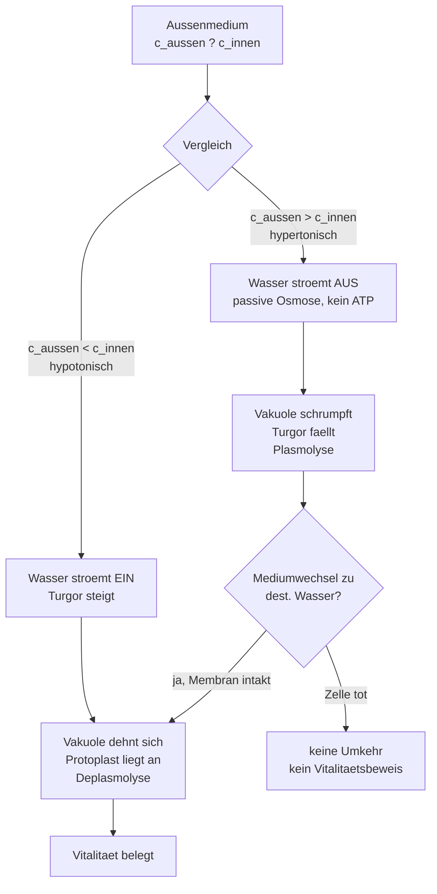

# Plasmolyse und Deplasmolyse im Experiment (质壁分离与复原实验)

> **0. 中文理解 (Der intuitive Anker)**：
> 红洋葱表皮就像一间间注水的小帐篷：细胞壁是固定的帐篷杆，里面的原生质体是充气内胆。把帐篷扔进浓盐水（高渗 KNO3），水被抽走，内胆干瘪脱离帐篷杆，这就是质壁分离；再扔回清水（低渗），水涌回来，内胆重新撑满贴杆，这就是复原。考场只问三件事：水往哪流、要不要 ATP、复原能不能证明细胞还活着。
>
> **Klausur-Relevanz (Abitur 核心考点定位)**：
> NRW KLP EF Zellbiologie 核心实验题，Operatoren analysieren + erklaeren（AFB II），常配显微镜照片给 Befund，要求三步：beschreiben（照片所见）→ analysieren（hypertonisch/hypotonisch + 水势方向）→ erklaeren（被动渗透 + 活细胞证明）。
>
> **关联导航**：前置 [[Biomembran-Transportmechanismen-und-Osmose]]（五种运输方式总表）· 配套互动微课 [[../../Lernreise/Bio-Biomembran-Plasmolyse-Experiment-L3]] · 后继 [[Enzymkinetik-und-Regulation]]（载体蛋白饱和动力学）。
> **Lernziel**：看到 KNO3 / dest. Wasser 情境，30 秒内判定水流方向、运输类型与能否用复原证明成活，并用德语因果链完整写出。

---

## 1. 核心概念 (Kernbegriffe)

### 1.1 术语与中德对齐表

| 术语 (DE) | 对应中文 | English (US/AP) | 严谨学术定义 (Fachsprache) / 核心公式 | 考场易错标记 |
|---|---|---|---|---|
| hypertonisch | 高渗的（外液更浓） | hypertonic | Aussenmedium mit hoeherer Konzentration osmotisch wirksamer Teilchen als das Zellinnere; Netto-Wasserausstrom | ⚠️ 不是"水多"，是"溶质多"；信号词 KNO3, Schrumpfen |
| hypotonisch | 低渗的（外液更稀） | hypotonic | Aussenmedium mit niedrigerer Teilchenkonzentration als das Zellinnere; Netto-Wassereinstrom | ⚠️ 信号词 dest. Wasser, Schwellen, Turgor |
| Plasmolyse | 质壁分离 | plasmolysis | Protoplast loest sich durch osmotischen Wasserausstrom von der Zellwand; Turgorverlust in hypertonischem Medium | ⚠️ 方向：失水、皱缩，不是胀破 |
| Deplasmolyse | 质壁分离复原 | deplasmolysis | Rueckstrom von Wasser in hypotonischem Medium; Protoplast legt sich wieder an; nur bei lebenden Zellen mit intakter Membran | ⚠️ 复原 = 成活证明，死细胞无复原 |
| Grenzplasmolyse | 临界质壁分离 | incipient plasmolysis | Zustand bei 50 % Abloesequote; Aussenpotenzial = Zellsaftpotenzial | ⚠️ 定量读数点：50 % 拐点 |
| Aquaporin | 水通道蛋白 | aquaporin | Kanalprotein fuer schnellen selektiven Wasserdurchtritt ohne Konformationsaenderung, ohne ATP | ⚠️ 无 ATP、无饱和；与载体蛋白区分 |
| Carrierprotein | 载体蛋白 | carrier protein | Transportprotein mit spezifischer Bindung + Konformationsaenderung, erleichterte Diffusion ohne ATP, mit Saettigung | ⚠️ 有特异性、有饱和、无 ATP |
| Na+/K+-Pumpe | 钠钾泵 | sodium-potassium pump | Primaer aktiver Transport: 3 Na+ hinaus, 2 K+ hinein gegen das Gefaelle, ATP-Verbrauch | ⚠️ 唯一"逆浓度 + 直接耗 ATP"的标杆 |
| Turgor | 膨压 | turgor pressure | Druck des Protoplasten gegen die Zellwand durch Wassereinstrom; Mass der Prallheit | ⚠️ 膨压是结果（水进来顶壁），渗透压是动力（溶质吸水） |
| Protoplast | 原生质体 | protoplast | Lebender Zellinhalt innerhalb der Zellwand (Membran + Cytoplasma + Vakuole) | ⚠️ 脱离/贴壁的主语是原生质体，不是细胞壁 |

### 1.2 系统 SBF 维度拆解

- **Struktur (系统结构与变量)**：Zwiebelepidermiszelle = starre Zellwand (Form) + Plasmalemma + Tonoplast (zwei selektiv permeable Membranen) + Vakuole mit Zellsaft + Aussenmedium (KNO3-Reihe oder dest. Wasser).
- **Verhalten (动态行为与演化因果)**：Aussenkonzentration bestimmt die Richtung des Wasserpotenzialgefaelles; Wasser folgt passiv ohne ATP; Vakuolenvolumen und Turgor folgen dem Strom; bei 50 % Abloesequote ist das Zellsaftpotenzial erreicht; Ruecktausch kehrt den Strom um.
- **Funktion (宏观功能与学科价值)**：Die Zelle nutzt Osmose zur Wasserversorgung und Turgor als Stuetzskelett; das Experiment macht unsichtbare Potenziale ueber die Protoplastenlage sichtbar und liefert einen Vitalitaetstest.

> *Klausur-Satz (德语核心公理句)*: `Das Wasserpotenzialgefaelle zwischen Aussenmedium und Zellsaft bestimmt Richtung und Staerke des osmotischen Wasserstroms durch die selektiv permeable Biomembran.`

> [!warning] Verwechslung 常见混淆点深度辨析
> 1. **Plasmolyse vs. Platzen（分离 vs. 胀破）**：Plasmolyse 是高渗失水、原生质体皱缩脱壁；Platzen（溶血/胀破）是低渗大量进水、动物细胞（无壁）破裂。植物细胞有壁，一般只胀到膨压平衡不破。考场看到"loest sich von der Wand"只能选 Plasmolyse。
> 2. **Aquaporin vs. Carrier vs. Pumpe（三通道终极辨别）**：Aquaporin 只过水、无构象变化、无 ATP、无饱和；Carrier 过溶质、有构象变化、有特异性、有饱和、无 ATP；Pumpe 逆浓度、有 ATP、无"顺浓度"可能。记忆钩：Wasser-Aqua-passiv / Bindung-Carrier-Saettigung / Gegen-Gefaelle-Pumpe-ATP。
> 3. **Osmotischer Druck vs. Turgor（吸力 vs. 顶力）**：渗透压是溶质吸水的动力（拉水进来），膨压是水进来后顶壁的压力（撑住形态）。Plasmolyse 中渗透压差抽水，膨压崩塌是后果，不是原因。
> 4. **Deplasmolyse beweist Leben（复原 = 成活）**：只有膜完整、半透性正常的活细胞才能定向回水复原；固定/煮死的细胞膜破裂，无选择透过性，不复原。凡题干问"Vitalitaet belegen"，答案锚点永远是 Umkehrbarkeit der Deplasmolyse。

> [!example] Musterantwort 考场高分可背诵抄写句
> *Durch das hypertonische Aussenmedium diffundiert Wasser osmotisch aus der Vakuole nach aussen. Infolgedessen verliert die Zelle ihren Turgor, und der Protoplast loest sich von der starren Zellwand ab (Plasmolyse). Durch anschliessende Zugabe des hypotonischen destillierten Wassers stroemt Wasser erneut in die Zelle ein, wodurch sich die Vakuole ausdehnt und der Protoplast wieder an die Zellwand anlegt (Deplasmolyse). Da die Umkehr eine intakte, selektiv permeable Membran voraussetzt, belegt sie die Vitalitaet der Zellen.*

---

## 2. 知识结构 (Struktur & Visual Schema)



### 2.1 核心原理解构

1. **Gefaealle entscheidet, nicht Menge**：只比较内外溶质浓度高低，不比较水量多少。水永远流向溶质更浓的一侧。
2. **Zwei Membranen, ein Weg**：水依次穿过 Plasmalemma（细胞膜）与 Tonoplast（液泡膜），两者都是选择透过膜；细胞壁全透性，只定形不定流。
3. **Passiv heisst ohne ATP**：整个 Plasmolyse/Deplasmolyse 过程零 ATP；凡写"aktiv gepumpt"即 0 分。Aquaporine 只加速，不供能。
4. **50 % liest das Potenzial**：浓度系列中恰好一半细胞分离时的外液浓度 = 细胞液浓度（Grenzplasmolyse），这是定量采分点。

> *Klausur-Satz*: `Bei der Grenzplasmolyse entspricht das Wasserpotenzial des Aussenmediums dem des Zellsafts, sodass die 50-%-Abloesequote das Zellsaftpotenzial direkt anzeigt.`

---

## 3. 解题方法 (Methoden & Entscheidungsbaum)

```diagram
        [题干信号词识别]
                  |
     +------------+------------+
     |                         |
 KNO3 / Saline /            dest. Wasser /
 Schrumpfen /               Schwellen /
 Abloesung                  Anliegen / Ruecktausch
     |                         |
 hypertonisch ->            hypotonisch ->
 Ausstrom-Analyse           Einstrom-Analyse
     |                         |
 1. Befund: Vakuole +       1. Befund: Vakuole +
    Protoplastenlage           Protoplastenlage
 2. Gefaelle + Osmose       2. Gefaelle + Osmose
    ohne ATP                   ohne ATP (+ Aquaporin)
 3. Plasmolyse-Fazit        3. Deplasmolyse +
    (+ Grenzpotenzial)          Vitalitaets-Fazit
```

### 3.1 专家解题标准步骤

1. **Schritt 1: Befund sichern (beschreiben)** —— 先只写所见：Vakuole gross/klein, Protoplast anliegend/abgeloest, Turgor hoch/niedrig。不下机制判断。
2. **Schritt 2: Gefaelle + Strom analysieren (analysieren)** —— 判 hypertonisch/hypotonisch → 水流方向 → 被动渗透、无 ATP → 与 Carrier/Pumpe 划界。
3. **Schritt 3: Deuten + Vitalitaet urteilen (erklaeren)** —— Plasmolyse/Deplasmolyse 命名 → 50 % 读数（如有系列）→ 复原可逆性 = 成活证明 → 回应题干设问一句话收束。

---

## 4. CN-Methode & Transfer (中德思维桥梁与技法衔接)

### CN-Methode: 浓度比较三秒判向法

- **技法优势与直觉转换**：中国课堂 quenches 口诀"水往高处（浓度高处）流"与本课完全同构；把 KNO3 浓度数字与细胞液浓度直接比大小，大的那侧就是水的终点，三秒定方向，再套德语三段写 ―― 先保方向分，再挣术语分。
- **DE-Anschluss (德国考纲合规对接)**：德国采分不认纯结论，必须写出 Gefaelle → passiver Transport ohne ATP → Protoplastenlage 因果链；"主动运输""细胞壁半透"为自动 0 分词，整卷禁用；Aquaporin 只在解释加速回流时提，Plasmolyse 主因永远是水势差。
- **符号规范化对照**：浓度 `1 mol/l KNO3`；水势 $\Psi$；钠钾泵 `3 Na+ hinaus / 2 K+ hinein`；hypertonisch/hypotonisch 拼写各带 h，不可缩写为 hyper/hypo。

---

## 5. Klausur-Training & Erwartungshorizont

### 5.1 官方题型定位

| 项 | 内容规范 |
|---|---|
| Aufgabenart | Klausuraufgabe mit Mikrofotos / AB-Experiment (Hilfsmittel: Lineal) |
| Operator | beschreiben, analysieren, erklaeren |
| AFB-Anforderung | AFB I (30 %) + AFB II (50 %) + AFB III (20 %) |
| 建议时长 / 分值 | 20 分钟 / 15 BE |

### 5.2 德语考卷满分原句 (Klausur-Satzbausteine)

- **定义重现句 (AFB I)**：*Eine Loesung heisst hypertonisch, wenn ihre Teilchenkonzentration hoeher ist als im Zellinneren; Wasser stroemt dann netto aus der Zelle aus.*
- **分析推导句 (AFB II)**：*Da das Aussenmedium hypertonisch ist, folgt Wasser dem Gefaelle passiv nach aussen, ohne ATP-Verbrauch; daraus ergibt sich der Turgorverlust mit Abloesung des Protoplasten.*
- **情境解释与评价句 (AFB III)**：*Im Sachzusammenhang bedeutet dies, dass nur die umkehrbare Deplasmolyse intakte Membranen und damit lebende Zellen nachweist; fixierte Zellen zeigen keine Umkehr.*

### 5.3 全真训练题与评分细则

**Aufgabe 1 [Originalgetreuer Kontext: Zwiebel-AB]**

> Rote Zwiebelhaut wird in drei Tropfen eingelegt: (A) destilliertes Wasser, (B) 0,3 mol/l KNO3, (C) 1,0 mol/l KNO3. Nach 5 Minuten: In A liegt der Protoplast prall an, in B loest er sich stellenweise, in C grossflaechig. Danach wird C gegen destilliertes Wasser getauscht: Der Protoplast legt sich wieder an.
> *Beschreiben Sie die Befunde und analysieren Sie die osmotischen Vorgaenge mit Fachbegriffen (analysieren).*

**Musterloesung mit BE-Verteilung**

1. Befund A: hypotonisches Medium, Wassereinstrom, Vakuole gedehnt, Protoplast anliegend, Turgor maximal *(2 BE)*
2. Befund C: hypertonisches 1,0 mol/l Medium, Wasserausstrom durch Plasmalemma + Tonoplast ohne ATP, Vakuole geschrumpft, Protoplast abgeloest = Plasmolyse *(4 BE)*
3. Befund B als Uebergang: Konzentration nahe dem Zellsaftpotenzial, teilweise Abloesung, Hinweis auf Grenzplasmolyse-Bereich *(2 BE)*
4. Wasseraustausch: hypotonische Umkehr, Rueckstrom (beschleunigt via Aquaporine), Deplasmolyse; Umkehr belegt intakte Membran und Vitalitaet *(4 BE)*
5. Antwortsatz: *Wasser folgt stets dem Wasserpotenzialgefaelle zur konzentrierteren Seite; die Protoplastenlage zeigt die Stromrichtung, die Umkehr das Leben.* *(3 BE)*

**Aufgabe 2 [Originalgetreuer Kontext: Transportweg-Diskrimination]**

> Eine Klausur behauptet: "Glucose gelangt wie Wasser durch Aquaporine per Osmose in die Zelle; die Na+/K+-Pumpe arbeitet ebenfalls ohne ATP entlang des Gefaelles." *Pruefen Sie beide Teilaussagen und erklaeren Sie die korrekten Transportwege (erklaeren).*

**Musterloesung mit BE-Verteilung**

1. Glucose-Aussage widerlegt: Glucose passiert via Carrierprotein (erleichterte Diffusion, spezifische Bindung + Konformationsaenderung), nicht via Aquaporin; Aquaporine fuehren nur Wasser *(4 BE)*
2. Gemeinsamkeit korrekt benannt: Beide Wege passiv ohne ATP entlang des Gefaelles, Carrier mit Saettigungskinetik *(3 BE)*
3. Pumpen-Aussage widerlegt: Na+/K+-Pumpe arbeitet primaer aktiv gegen das Gefaelle (3 Na+ hinaus, 2 K+ hinein) mit ATP-Verbrauch *(4 BE)*
4. Antwortsatz: *Kanal und Carrier folgen dem Gefaelle ohne ATP, die Pumpe baut es mit ATP auf; wer Richtung und Energiebedarf vertauscht, verliert die Deutung.* *(4 BE)*

---

## 6. Fehlerquellen & Kontrast (易混对抗矩阵)

| 混淆概念对 / 典型错误 | 概念本质差异 | 图像/符号表征差异 | 阅卷老师扣分红线与防错绝招 |
|---|---|---|---|
| **Plasmolyse vs. Platzen** | 失水皱缩脱壁 vs. 进水胀破 | 脱壁 + 液泡缩小 vs. 膜破裂 + 内容物外泄 | 见"abgeloest"只写 Plasmolyse；Platzen 需无壁细胞 + 大量进水前提 |
| **Aquaporin vs. Carrierprotein** | 水专属、无构象、无饱和 vs. 溶质专属、有构象、有饱和 | 通道直通过 vs. 结合-变构-释放 | Glucose/离子题绝不写 Aquaporin；"Saettigung"只属于 Carrier（+ Enzyme） |
| **Passiv (Osmose) vs. Aktiv (Pumpe)** | 顺浓度、零 ATP vs. 逆浓度、耗 ATP | Gefaelle-Pfeil abwaerts vs. ATP-Pfeil aufwaerts | Plasmolyse 全程禁写 aktiv/ATP；Pumpe 必须写 3:2 + ATP |
| **Osmotischer Druck vs. Turgor** | 溶质吸水动力 vs. 水顶壁压力 | 浓度差箭头 vs. 壁反作用力箭头 | 原因永远是渗透压差，膨压是后果；因果倒置扣 AFB II 全部分 |
| **高发陷阱：Zellwand semipermeabel** | 细胞壁全透、只定形；选择透过的是膜 | 壁虚线（全过）vs. 膜实线（选择） | 写"壁半透"整问 0 分；双膜名词 Plasmalemma + Tonoplast 写全 |

---

## 7. Vernetzung & Meta-Transfer (融会贯通与跨学科迁移)

- **学科横向联结 (Interdisziplinaer)**：
  - 化学：Konzentrationsgefaelle 与 Fick 扩散定律同构；KNO3 解离粒子数（van-t-Hoff-Faktor）决定渗透效力。
  - 物理：Turgor 即静水压；Grenzplasmolyse 是生物版"零点标定法"。
- **认知系统上下游**：
  - 前置奠基节点：[[Biomembran-Transportmechanismen-und-Osmose]]（五机制总表）· [[Zellbiologie-Grundlagen]]（动植物细胞结构）
  - 后继进阶节点：[[Enzymkinetik-und-Regulation]]（载体饱和与米氏动力学）· [[Signaltransduktion]]（膜蛋白信号功能）
- **Anki 术语记忆卡沉淀**：
  - `Aquaporin;水通道蛋白;Aquaporine lassen Wasser ohne ATP und ohne Konformationsaenderung passieren.;Bio;Biomembran`
  - `hypertonisch;高渗的（外液更浓）;Hypertonisches KNO3 zieht Wasser osmotisch aus der Zelle.;Bio;Biomembran`
  - `hypotonisch;低渗的（外液更稀）;Destilliertes Wasser ist hypotonisch und loest Deplasmolyse aus.;Bio;Biomembran`
  - `Grenzplasmolyse;临界质壁分离;Bei 50 Prozent Abloesung entspricht das Aussenpotenzial dem Zellsaftpotenzial.;Bio;Biomembran`
  - `Protoplast;原生质体;Der Protoplast loest sich bei Wasserverlust von der Zellwand ab.;Bio;Biomembran`
